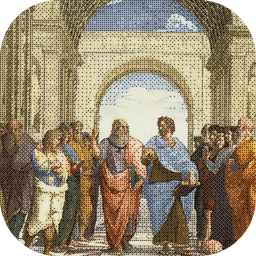
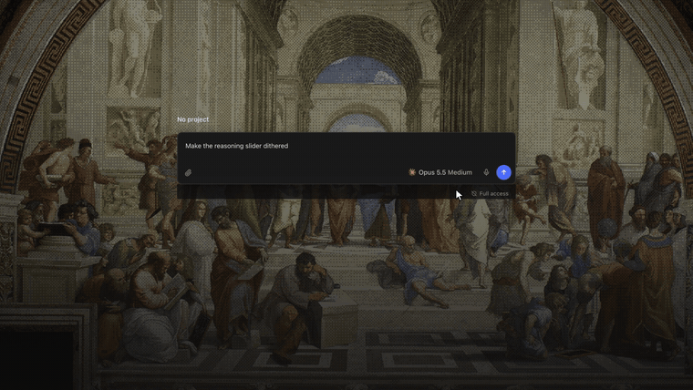
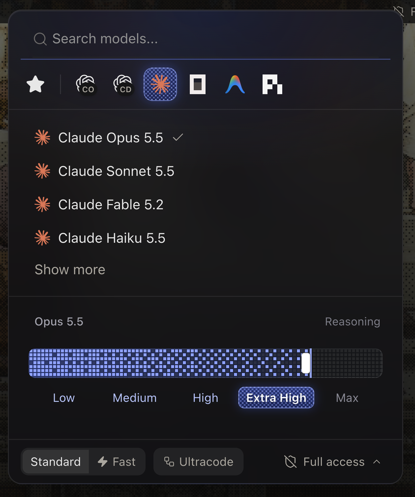
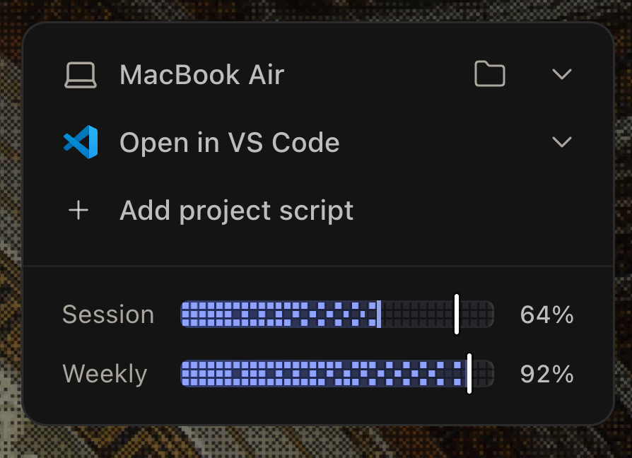

<div align="center">
  

  <h1>Fresco</h1>

  <p><strong>A dithered Renaissance theme for T3 Code.</strong></p>
  <p>
    Raphael's <em>School of Athens</em>, rendered in pixels behind a quiet dark UI.<br />
    It also adds a glass model picker, a dithered reasoning slider, and pixel usage meters that match it.
  </p>

  <p>
    <a href="#install">Install</a> ·
    <a href="#see-fresco-in-action">Screenshots</a> ·
    <a href="https://github.com/PratikRai0101/fresco-t3-theme/issues">Issues</a> ·
    <a href="#contributing">Contribute</a>
  </p>

  <p>
    <a href="https://github.com/pingdotgg/t3code"></a>
    <a href="#how-it-works"></a>
    <a href="#install"></a>
    <a href="LICENSE"></a>
    <a href="https://github.com/PratikRai0101/fresco-t3-theme/stargazers"></a>
  </p>

  

  <p><sub>Install in one line (macOS / Linux):</sub></p>

```bash
mkdir -p ~/.t3/userdata/themes && cd ~/.t3/userdata/themes && curl -fsSLO https://raw.githubusercontent.com/PratikRai0101/fresco-t3-theme/main/fresco.json && curl -fsSLO https://raw.githubusercontent.com/PratikRai0101/fresco-t3-theme/main/fresco.webp
```

</div>

> [!NOTE]
> **Fresco targets T3 Code Nightly.** The picker and meter styles hook into T3's markup, so a T3 update can occasionally move things. If something looks off, [open an issue](https://github.com/PratikRai0101/fresco-t3-theme/issues) with a screenshot.

## Why Fresco?

Most editor themes change the colours and leave it there. Fresco treats T3 Code like a canvas:
- **The painting:** a Renaissance fresco sits behind every chat, dithered so it reads as texture rather than noise.
- **The controls:** the parts you touch most, the model picker and the reasoning effort, get the same pixel language, so the whole app feels like one piece.

It's a single CSS theme. There's nothing to run and nothing to patch, and you can remove it in one click.

## See Fresco in action

<p align="center">
  
  <br />
  <sub><strong>A new chat</strong>: the painting fills the canvas, and the picker opens below the composer instead of over it.</sub>
</p>

<table>
  <tr>
    <td width="50%"></td>
    <td width="50%"></td>
  </tr>
  <tr>
    <td align="center"><strong>One glass picker</strong><br /><sub>Search, providers, models and reasoning in a single column</sub></td>
    <td align="center"><strong>Meters that match</strong><br /><sub>Session, Weekly and Context in the same pixel ramp</sub></td>
  </tr>
</table>

<p align="center"><sub>Actual T3 Code interface. Thread names in the sidebar are demo text.</sub></p>

## What it does

### A painting, not a wallpaper

- Raphael's *School of Athens*, Bayer-dithered and sized to the chat area
- A soft vignette that darkens toward the composer, so text always stays readable
- In long chats, messages sit on a calm centre column, with the painting at the edges

### A glass model picker

- One column: search, a row of provider icons, the model list, then reasoning
- A frosted, blurred panel with a faint blue glow
- The selected provider gets a dithered blue tile
- In a new chat it opens **below** the centred composer, not on top of it

### A dithered reasoning slider

- A pixel ramp that fills from dense to sparse as you raise the effort
- A white thumb, tick marks, and labelled buttons for every level underneath: Low, Medium, High, Extra High, Max
- Works with any model that offers effort levels, and with On/Off thinking toggles

### Meters that match

- **Session**, **Weekly** and **Context** in the thread details panel use the same pixel ramp as the slider
- They turn amber at a warning and red at an error
- White ticks mark the pace on usage limits and the auto-compact point on Context

## Install

### Requirements

- T3 Code (Nightly). Tested on macOS; Linux uses the same `~/.t3/userdata/themes` folder
- `curl` for the one-line install, or a browser for the manual one

### One line

```bash
mkdir -p ~/.t3/userdata/themes && cd ~/.t3/userdata/themes && \
curl -fsSLO https://raw.githubusercontent.com/PratikRai0101/fresco-t3-theme/main/fresco.json && \
curl -fsSLO https://raw.githubusercontent.com/PratikRai0101/fresco-t3-theme/main/fresco.webp
```

Then open **Settings → Appearance** and pick **Fresco**. If it doesn't show up, restart T3 Code.

### Manually

Download [`fresco.json`](fresco.json) and [`fresco.webp`](fresco.webp) and put both in `~/.t3/userdata/themes/`. Keep both files side by side with the same name, because the `.webp` is the background painting.

| Task | How |
| --- | --- |
| Update | Run the install line again |
| Switch back | Settings → Appearance → any built-in theme |
| Uninstall | Delete `fresco.json` and `fresco.webp` from `~/.t3/userdata/themes/` |

## Quick start

1. Pick **Fresco** in Settings → Appearance.
2. Start a new chat and open the model picker. It drops below the composer.
3. Right-click the thread details panel and turn on **Usage limits** and **Context window** to see the pixel meters.
4. Optional: set where the Context tick sits in **Settings → Providers → Claude → Auto-compact after**.

## How it works

Fresco is a standard T3 Code theme. Colour roles set the palette, and a CSS block restyles specific parts of the app.

| Part | What it does |
| --- | --- |
| `colors` | A dark palette with a single blue accent (`#4D6BFE`) |
| `fresco.webp` | The dithered painting, shown through `var(--theme-background-image)` |
| Picker CSS | Turns the picker into one column, using flex `order` and `display: contents` |
| Slider CSS | Counts effort levels with `:has()` and sizes the dithered fill to the selected level |
| Meter CSS | Pixel ramps drawn as SVG `<pattern>` bands that scale to any bar width |
| Empty-chat rule | Detects the centred composer and moves the picker below it |

Every dither is drawn with inline SVG, and the only image file is the painting.

## Project status

Fresco is stable on T3 Code Nightly and gets updated when T3 changes its markup. Ideas that need T3 itself to support them, not just a theme:

- [ ] Drag to set the reasoning level, with trackpad haptics
- [ ] A Compact button and a draggable compaction tick on the Context meter
- [ ] A light variant with a second painting

## Contributing

Issues and focused pull requests are welcome.

1. Check the [open issues](https://github.com/PratikRai0101/fresco-t3-theme/issues), or open one with a screenshot.
2. Keep selectors on T3's stable `data-*` attributes where possible, because class names change between releases.
3. Never nest `:has()` inside `:has()`. Browsers silently drop the whole rule.
4. Check changes in a new chat and an existing chat, with the picker open and closed.

## Credits

- Background: Raphael, *The School of Athens* (1509–1511), public domain. Photo via Wikimedia Commons.
- Picker layout inspired by [Nyx Plus](https://x.com/Deepusleepy) by Deepu.
- Built for [T3 Code](https://github.com/pingdotgg/t3code). Fresco isn't affiliated with T3 or Ping.

## License

Fresco is available under the [MIT License](LICENSE). The painting is in the public domain.

## Support the project

If Fresco makes your T3 Code nicer to look at, [star the repository](https://github.com/PratikRai0101/fresco-t3-theme). It helps other people find it.
