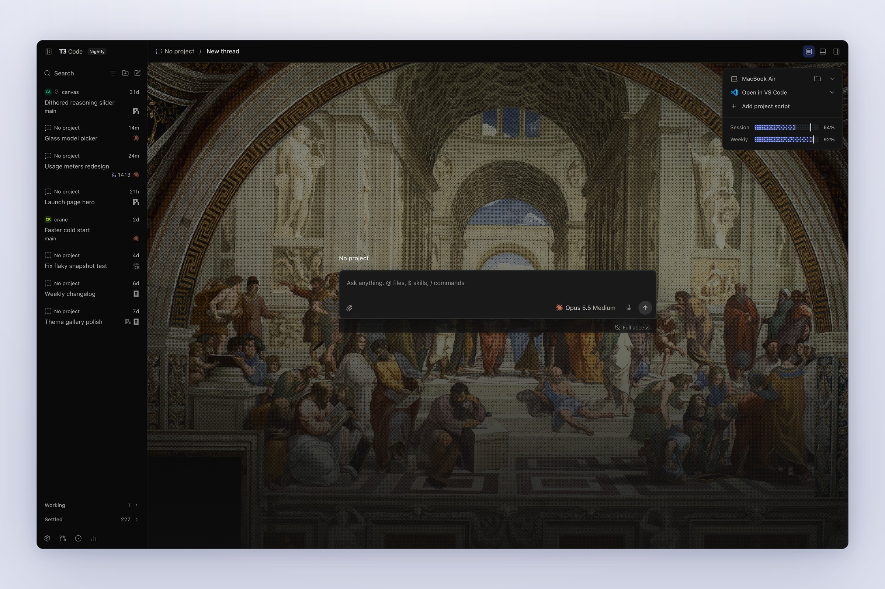
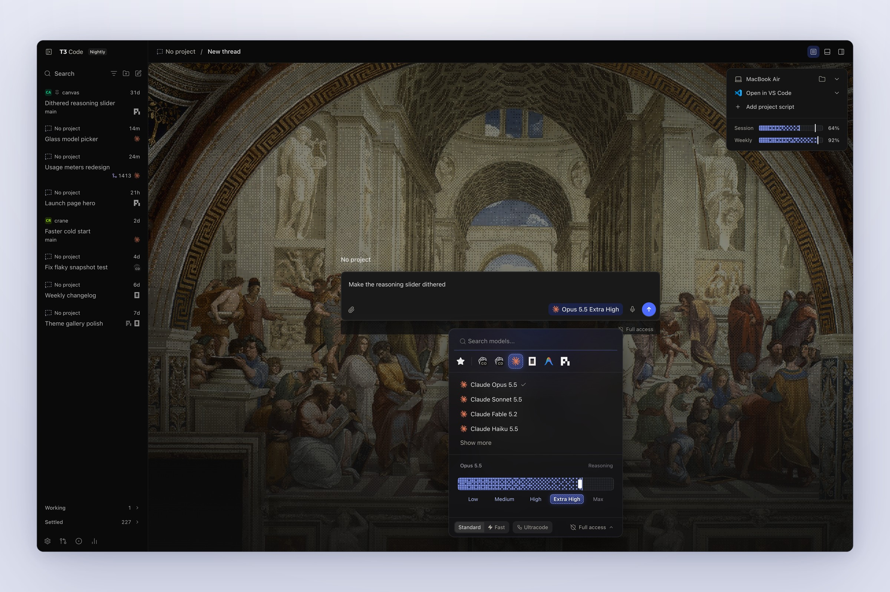

# Fresco

**A dithered Renaissance theme for [T3 Code](https://github.com/pingdotgg/t3code).**

Raphael's *School of Athens*, dithered, behind a dark UI. The theme also restyles the model picker and the usage meters:

- **Glass model picker:** a single column with search, a row of provider icons, the model list, and the reasoning slider underneath.
- **Dithered reasoning slider:** a pixel fill with labelled level buttons.
- **Pixel meters:** Session, Weekly and Context use the same dither as the slider.
- **Picker placement:** in a new chat, the picker opens below the centred composer.


https://github.com/PratikRai0101/fresco-t3-theme/raw/main/screenshots/demo.mp4

## Install

### One command (macOS / Linux)

```sh
mkdir -p ~/.t3/userdata/themes && cd ~/.t3/userdata/themes && \
curl -fsSLO https://raw.githubusercontent.com/PratikRai0101/fresco-t3-theme/main/fresco.json && \
curl -fsSLO https://raw.githubusercontent.com/PratikRai0101/fresco-t3-theme/main/fresco.webp
```

Then open **Settings → Appearance** in T3 Code and pick **Fresco**. If it doesn't show up, restart T3 Code.

### Manually

Download `fresco.json` and `fresco.webp` and put both in `~/.t3/userdata/themes/`. Keep both files side by side with the same name, because the `.webp` is the background painting.

### Turn on the meters (optional)

Right-click the thread details panel and turn on **Usage limits** and **Context window**.

## Notes

- Built and tested on T3 Code Nightly. The picker and meter styles hook into T3's markup, so a future release may need an update. If something breaks, please open an issue.
- Tip: you can set the compaction point shown on the Context meter in Settings → Providers → Claude → *Auto-compact after*.

## Screenshots

| Details panel | Model picker |
|---|---|
|  |  |

## Credits

- Background: Raphael, *The School of Athens* (1509–1511), public domain.
- Picker layout inspired by [Nyx Plus](https://x.com/Deepusleepy) by Deepu.

## License

The theme's CSS and JSON are under the MIT license. The painting is public domain.
